<picture>
  <source media="(prefers-color-scheme: dark)" srcset="assets/dark/hero.svg">
  
</picture>

  <a href="https://www.akshaybajpai.com"><b>akshaybajpai.com</b></a>
  &nbsp;&nbsp;·&nbsp;&nbsp;
  <a href="https://www.linkedin.com/in/ax5hay"><b>LinkedIn</b></a>
  &nbsp;&nbsp;·&nbsp;&nbsp;
  <a href="https://x.com/ax5hay"><b>@ax5hay</b></a>
  &nbsp;&nbsp;·&nbsp;&nbsp;
  <a href="mailto:contact@akshaybajpai.com"><b>contact@akshaybajpai.com</b></a>

Last updated <!-- updated:start -->11 November 2026<!-- updated:end -->. Every plate below is re-issued daily.

 

<picture>
  <source media="(prefers-color-scheme: dark)" srcset="assets/dark/h-notes.svg">
  
</picture>

<!-- notes:start -->
<picture>
  <source media="(prefers-color-scheme: dark)" srcset="assets/dark/notes.svg">
  
</picture>

The same notes as text

 

1. **Thrust is cheap. Controlled thrust is the whole job.** Shipping a demo is thrust. Keeping it upright in production is trust.
2. **I sit on both sides of the table.** In the room with clients and executives for the readout, the scope and the sign-off; back in the code for the hard parts. Nothing is lost in translation, because there is no translation.
3. **I own systems from the first drawing to the runbook.** The architecture, the product, the safety layer, the release, and the team that builds it. The same hands write a Rust power API, a guarded SQL agent and a Terraform module.
4. **Most of the work sits in the unglamorous middle.** Orchestration, the schema that refuses bad data, the job queue that survives a restart.
5. **Decisions are written down.** Decision records, specs, runbooks and handoff notes ship with the code, so the next team starts where I stopped.
6. **Numbers come with their conditions.** When a figure appears in one of my READMEs, a results file sits behind it.
7. **AI where it earns its place.** When a saved answer or a plain rule will do, no model is called. Everything else fails loud.

<!-- notes:end -->

 

<picture>
  <source media="(prefers-color-scheme: dark)" srcset="assets/dark/h-record.svg">
  
</picture>

What the work was and what it changed, without letterheads or dates. Two of these I ran as CTO, where the architecture, the people and the delivery were one job; the rest I led from the code outward. In most of them I was also the client's main technical voice, from the first scoping call to acceptance.

<picture>
  <source media="(prefers-color-scheme: dark)" srcset="assets/dark/teststand.svg">
  
</picture>

<b>The record, engagement by engagement</b> · what each one was, and every number behind the gauges

 

<table>
<tbody>
<tr>
<td width="200" valign="top"><b>Defence video intelligence</b> agentic AI · air-gapped</td>
<td valign="top">An agentic platform that watches round-the-clock CCTV for government defence deployments. LangGraph and MCP agents triage detections, classify events and escalate alerts; Kafka feeds asynchronous inference; the whole stack runs self-contained on air-gapped, on-premise hardware. I owned the architecture, the inference, the infrastructure and the operators' dashboards. Analyst intervention down 70% &nbsp;·&nbsp; under 200 ms from ingestion to decision</td>
</tr>
<tr>
<td valign="top"><b>Multi-tenant health AI</b> forward-deployed · several clients</td>
<td valign="top">Lead engineer across several client programmes at once, and their main technical voice to product and executive teams. A fertility and surrogacy platform with three coordinated assistants. A governed natural-language-to-SQL agent with schema-grounded routing, query preview, mandatory human confirmation and audit-friendly execution. And the shared LLM layer under every bot: one gateway, tiered routing, hybrid retrieval with reranking, per-bot keys, caching and fallbacks, all on AWS CDK. Reporting rebuilt on 8,000+ approved columns across 193 tables &nbsp;·&nbsp; 100+ legacy prompts retired &nbsp;·&nbsp; full automated pass at staging sign-off</td>
</tr>
<tr>
<td valign="top"><b>Prototype to federal SaaS</b> real-estate AI</td>
<td valign="top">Took an AI prototype of my own and made it a production SaaS platform for a US federal use case, owning the AI workflows, the application, the infrastructure and the delivery. From a working prototype to a deployed product</td>
</tr>
<tr>
<td valign="top"><b>Restaurant-operations SaaS</b> forecasting · event pipelines</td>
<td valign="top">The AI and full-stack engineering for a restaurant platform, and the team of eight that built it: XGBoost and Prophet forecasting behind a Next.js operators' dashboard, and event pipelines designed and load-tested for real-time demand sensing. Validated across 200+ restaurants &nbsp;·&nbsp; 32% less food waste &nbsp;·&nbsp; 2M+ events a day under 100 ms</td>
</tr>
<tr>
<td valign="top"><b>Finance and healthcare AI</b> agents · fine-tuned models</td>
<td valign="top">Agentic finance workflows in LangGraph across risk profiling, rebalancing and onboarding, with tool routing, retries and memory between steps. Multimodal pipelines over health records and diagnostic images, on open models fine-tuned with QLoRA inside HIPAA- and GDPR-compliant AWS, served through hybrid retrieval with reranking and domain guardrails. 60% fewer manual touchpoints &nbsp;·&nbsp; 94% precision &nbsp;·&nbsp; inference cost down 80% &nbsp;·&nbsp; under 800 ms at p95</td>
</tr>
<tr>
<td valign="top"><b>Insurance document intelligence</b> multimodal extraction · RAG</td>
<td valign="top">A production platform for long, messy insurance documents: Claude, GPT-4 Vision and LayoutLMv3 on AWS Bedrock, OCR into retrieval, automated evaluations, and gradient-boosted ensembles for underwriting. 95%+ extraction accuracy &nbsp;·&nbsp; underwriting efficiency up 78% &nbsp;·&nbsp; 10K+ queries a day</td>
</tr>
<tr>
<td valign="top"><b>Clinical NLP</b> health records · risk scoring</td>
<td valign="top">Structured variables pulled out of unstructured health records with BioBERT, spaCy and custom sequence labelling, and the risk-scoring models that fed triage. 47+ variables at 91.5% accuracy &nbsp;·&nbsp; 5K+ documents a day</td>
</tr>
<tr>
<td valign="top"><b>Research</b> published · MSc</td>
<td valign="top">Lead author of a peer-reviewed book chapter on machine learning for medical diagnosis. MSc in Artificial Intelligence and Intelligent Systems with distinction (9.8/10), with a thesis benchmarking nine models for Alzheimer's classification. ISBN 978-3-031-60815-5</td>
</tr>
</tbody>
</table>

 

<picture>
  <source media="(prefers-color-scheme: dark)" srcset="assets/dark/h-keyplan.svg">
  
</picture>

<picture>
  <source media="(prefers-color-scheme: dark)" srcset="assets/dark/keyplan.svg">
  
</picture>

 

<picture>
  <source media="(prefers-color-scheme: dark)" srcset="assets/dark/h-index.svg">
  
</picture>

<!-- index:start -->
<picture><source media="(prefers-color-scheme: dark)" srcset="assets/dark/cards/zone-a.svg"></picture>

<a href="https://github.com/ax5hay/AURIXA"><picture><source media="(prefers-color-scheme: dark)" srcset="assets/dark/cards/a-01.svg"></picture></a>
<picture><source media="(prefers-color-scheme: dark)" srcset="assets/dark/cards/a-02.svg"></picture>
<a href="https://github.com/ax5hay/GHDA-SaaS"><picture><source media="(prefers-color-scheme: dark)" srcset="assets/dark/cards/a-03.svg"></picture></a>
<a href="https://github.com/ax5hay/OCR-LLM-DIST"><picture><source media="(prefers-color-scheme: dark)" srcset="assets/dark/cards/a-04.svg"></picture></a>
<a href="https://github.com/ax5hay/ai-automation-main"><picture><source media="(prefers-color-scheme: dark)" srcset="assets/dark/cards/a-05.svg"></picture></a>
<a href="https://github.com/ax5hay/JobSlave"><picture><source media="(prefers-color-scheme: dark)" srcset="assets/dark/cards/a-06.svg"></picture></a>
<a href="https://github.com/ax5hay/OCR-LocalLLM"><picture><source media="(prefers-color-scheme: dark)" srcset="assets/dark/cards/a-07.svg"></picture></a>

<picture><source media="(prefers-color-scheme: dark)" srcset="assets/dark/cards/zone-v.svg"></picture>

<a href="https://github.com/ax5hay/Vigilix"><picture><source media="(prefers-color-scheme: dark)" srcset="assets/dark/cards/v-01.svg"></picture></a>
<a href="https://github.com/ax5hay/DADM-Aiximius"><picture><source media="(prefers-color-scheme: dark)" srcset="assets/dark/cards/v-02.svg"></picture></a>
<picture><source media="(prefers-color-scheme: dark)" srcset="assets/dark/cards/v-03.svg"></picture>
<a href="https://github.com/ax5hay/KeepMeAwake"><picture><source media="(prefers-color-scheme: dark)" srcset="assets/dark/cards/v-04.svg"></picture></a>

<picture><source media="(prefers-color-scheme: dark)" srcset="assets/dark/cards/zone-d.svg"></picture>

<a href="https://github.com/ax5hay/AIDA"><picture><source media="(prefers-color-scheme: dark)" srcset="assets/dark/cards/d-01.svg"></picture></a>
<a href="https://github.com/ax5hay/RestroScraper-PY"><picture><source media="(prefers-color-scheme: dark)" srcset="assets/dark/cards/d-02.svg"></picture></a>
<a href="https://github.com/ax5hay/TracePulse"><picture><source media="(prefers-color-scheme: dark)" srcset="assets/dark/cards/d-03.svg"></picture></a>
<picture><source media="(prefers-color-scheme: dark)" srcset="assets/dark/cards/d-04.svg"></picture>

<picture><source media="(prefers-color-scheme: dark)" srcset="assets/dark/cards/zone-w.svg"></picture>

<a href="https://github.com/ax5hay/MirrorState"><picture><source media="(prefers-color-scheme: dark)" srcset="assets/dark/cards/w-01.svg"></picture></a>
<a href="https://github.com/ax5hay/akshaybajpai.com"><picture><source media="(prefers-color-scheme: dark)" srcset="assets/dark/cards/w-02.svg"></picture></a>
<a href="https://github.com/ax5hay/medhathapliyal.site"><picture><source media="(prefers-color-scheme: dark)" srcset="assets/dark/cards/w-03.svg"></picture></a>
<a href="https://github.com/ax5hay/aiximius.com"><picture><source media="(prefers-color-scheme: dark)" srcset="assets/dark/cards/w-04.svg"></picture></a>
<a href="https://github.com/ax5hay/ew-dashboard"><picture><source media="(prefers-color-scheme: dark)" srcset="assets/dark/cards/w-05.svg"></picture></a>
<a href="https://github.com/ax5hay/Merakiel.in"><picture><source media="(prefers-color-scheme: dark)" srcset="assets/dark/cards/w-06.svg"></picture></a>

<b>R-01 to R-07</b> · research notebooks from earlier flight tests

 

<picture><source media="(prefers-color-scheme: dark)" srcset="assets/dark/cards/zone-r.svg"></picture>

<a href="https://github.com/ax5hay/AlzheimersDiagnosis"><picture><source media="(prefers-color-scheme: dark)" srcset="assets/dark/cards/r-01.svg"></picture></a>
<a href="https://github.com/ax5hay/GAN-Anime-Faces"><picture><source media="(prefers-color-scheme: dark)" srcset="assets/dark/cards/r-02.svg"></picture></a>
<a href="https://github.com/ax5hay/CNN-Chinese-MNIST"><picture><source media="(prefers-color-scheme: dark)" srcset="assets/dark/cards/r-03.svg"></picture></a>
<a href="https://github.com/ax5hay/RNN_TheSocialDilemma"><picture><source media="(prefers-color-scheme: dark)" srcset="assets/dark/cards/r-04.svg"></picture></a>
<a href="https://github.com/ax5hay/Stock-Market-Prediction-GRU"><picture><source media="(prefers-color-scheme: dark)" srcset="assets/dark/cards/r-05.svg"></picture></a>
<a href="https://github.com/ax5hay/Cervical-Cancer-Classification"><picture><source media="(prefers-color-scheme: dark)" srcset="assets/dark/cards/r-06.svg"></picture></a>
<a href="https://github.com/ax5hay/Hangman_API_Optimisation_Problem"><picture><source media="(prefers-color-scheme: dark)" srcset="assets/dark/cards/r-07.svg"></picture></a>

<!-- index:end -->

 

<picture>
  <source media="(prefers-color-scheme: dark)" srcset="assets/dark/h-schedule.svg">
  
</picture>

<picture>
  <source media="(prefers-color-scheme: dark)" srcset="assets/dark/schedule.svg">
  
</picture>

The same schedule as text, for searching and copying

 

<!-- schedule:start -->
- **Leadership & practice.** Technical leadership, Building engineering teams, Client & stakeholder ownership, Product strategy & roadmaps, Executive & C-suite readouts, Scope negotiation, Release governance & UAT, Forward-deployed engineering, System architecture, Design docs & specs, Architecture decision records, Runbooks & operations, Security policy & threat modelling, Multi-tenant SaaS design, Air-gapped delivery, LLM evals & cost engineering, Resource & inference budgets, Cross-platform release pipelines, Changelogs & semver, Conventional commits, Handoff notes, Agentic dev workflows, UX writing in plain words, Brand & visual design
- **Languages.** TypeScript, Python, JavaScript, C#, Rust, SQL, Bash, HTML & CSS, SCSS, Cypher, HCL, Google Apps Script
- **Frontend & UI.** React, Next.js, Angular, Astro, Svelte 5, Vite, Create React App, Tailwind CSS, Sass, Bootstrap, Radix UI, shadcn/ui, React Aria, Framer Motion, TanStack Query, Zustand, React Router, RxJS, Storybook, Lucide, Quill, Swiper, remark / rehype, Transloco i18n, View Transitions API, JSON-LD / schema.org, Satori, resvg, cmdk, CodeMirror, Sonner, Liquid Glass (SVG lensing)
- **Charts & dataviz.** Recharts, Observable Plot, uPlot, Apache ECharts, Charts.css, Matplotlib, Seaborn, Plotly
- **Backend & APIs.** Node.js, Fastify, NestJS, Express, FastAPI, Starlette, Flask, Uvicorn, Gunicorn, ASP.NET Core, .NET 8 / 10, Socket.IO, WebSockets, SignalR, Server-sent events, AG-UI event stream, OpenAPI / Swagger, Zod, Pydantic, class-validator, Joi, JWT, OpenID Connect, ASP.NET Identity, Argon2, bcrypt, Helmet, Rate limiting, BullMQ, Hangfire, APScheduler, Lease-based job queue, node-cron, Polly, AutoMapper, Multer, Axios / httpx, aiohttp, Flurl, reqwest, tokio, serde, thiserror, parking_lot, chrono
- **AI & LLM systems.** OpenAI API, Anthropic Claude, Google Gemini, Ollama, LM Studio, Pydantic AI, OpenRouter, LangChain, RAG pipelines, Text-to-SQL agents, MCP servers, LLM guardrails, Prompt & schema contracts, Model cascades, Prompt caching, pydantic-evals, Arize Phoenix, sentence-transformers, fastembed, FAISS, BM25, Reciprocal rank fusion, Weaviate, tiktoken, natural / compromise NLP, fuzzy matching, faster-whisper, Vosk, SpeechBrain, Piper TTS, edge-tts, pyttsx3
- **Machine learning & data science.** PyTorch, torchvision, TensorFlow, Keras, scikit-learn, imbalanced-learn, SHAP, NumPy, pandas, SciPy, scikit-image, joblib, h5py, ndarray (Rust), ONNX, ONNX Runtime, Jupyter, yfinance, jStat, Federated learning, CNNs, RNNs & GRUs, GANs, Anomaly detection
- **Vision, audio & documents.** OpenCV, YOLO / Ultralytics, MediaPipe, dlib, supervision, Pose & posture estimation, PPE detection, ANPR (number plates), Multi-signal threat scoring, Pillow, imutils, RTSP ingest, FFmpeg, PyAV, MoviePy, sounddevice / pydub, EasyOCR, Tesseract, PyMuPDF, pdfplumber, PyPDF2, pdf-parse / pdf.js, Docnet, ReportLab, python-docx, EPUB (VersOne), NetVips, sharp, node-canvas, QR codes, ExcelJS / xlsx, openpyxl, CsvHelper
- **Data stores & ORMs.** PostgreSQL, MySQL / MariaDB, Redis, SQLite, SQLite FTS5, Neo4j, MinIO / S3, Weaviate (vector), FAISS (vector), pgvector, Supabase, Prisma, Drizzle ORM, SQLAlchemy, Alembic, asyncpg, psycopg, sqlglot (SQL ASTs), Entity Framework Core, PL/pgSQL, PostgreSQL row-level security, JSONB storage, cache-manager / EasyCaching, Google Sheets as a store
- **Infrastructure & delivery.** Docker, Docker Compose, Kubernetes, Helm, Terraform, Ansible, AWS, Amazon EKS, Amazon RDS, ElastiCache, Amazon ECR, VPC networking, vSphere, Nginx, GitHub Actions, Dependabot, GitHub Pages, GitHub Releases, Signed auto-updates, NSIS & DMG installers, Relocatable Python runtime, Docker Buildx, crane, Turborepo, pnpm workspaces, npm workspaces, uv, Make, Air-gapped, zero-trust deploys
- **Observability & security.** Prometheus, Grafana, Loki & Promtail, OpenTelemetry, Arize Phoenix tracing, Pino, Winston, Loguru, Serilog, tracing (Rust), TracePulse (my own), Trivy, oauth2-proxy, OS credential store (keyring), Content Security Policy, Secret & PII detection, CodeQL / SARIF, SonarAnalyzer, Codecov, Husky & lint-staged, commitlint, pre-commit, AES-GCM / ring, rustls, cryptography (py), SHA-2 / HMAC, Data Protection API
- **Testing & code quality.** Vitest, Jest, pytest, pytest-asyncio, Playwright, Selenium, Testing Library, jsdom, Supertest, xUnit, NSubstitute, BenchmarkDotNet, criterion (Rust), cargo test, Clippy (pedantic), rustfmt, svelte-check, Golden-set evals, Metamorphic SQL probes, Karma, ESLint, typescript-eslint, Prettier, Ruff, Black, mypy, Pylint, flake8, markdownlint, Storybook a11y
- **Desktop, edge & automation.** Tauri 2, Electron, electron-vite, electron-builder, System tray & menu bar apps, Win32 power requests, IOKit / Core Foundation, Global hotkeys, PySide6 / Qt, Tkinter, Streamlit, NiceGUI, Rust edge agent, sysinfo, Windows API (Rust), Playwright automation, Selenium scraping, BeautifulSoup / lxml, Cheerio, HtmlAgilityPack, SurveyCTO, ngrok
- **Integrations & services.** Twilio, WhatsApp & Instagram channels, Nodemailer, MailKit, Google Sheets API, Google Calendar, Apps Script / clasp, Naukri.com automation, OpenGraph & sitemaps, Webhooks
<!-- schedule:end -->

 

<picture>
  <source media="(prefers-color-scheme: dark)" srcset="assets/dark/h-numbers.svg">
  
</picture>

<picture>
  <source media="(prefers-color-scheme: dark)" srcset="assets/dark/numbers.svg">
  
</picture>

Every plate on this page is drawn by <a href="scripts/render.py">one script</a> from the data in this repository, in the same type and ink as <a href="https://www.akshaybajpai.com">the site</a>, and re-issued daily by a GitHub Action. The motion is CSS and SMIL inside each SVG: no scripts, no GIFs, no third-party cards, no grades. With reduced motion on, every plate rests as a finished drawing. Switch your theme to see the other issue: paper by day, blueprint by night.

 
 

<picture>
  <source media="(prefers-color-scheme: dark)" srcset="assets/dark/closing.svg">
  
</picture>
