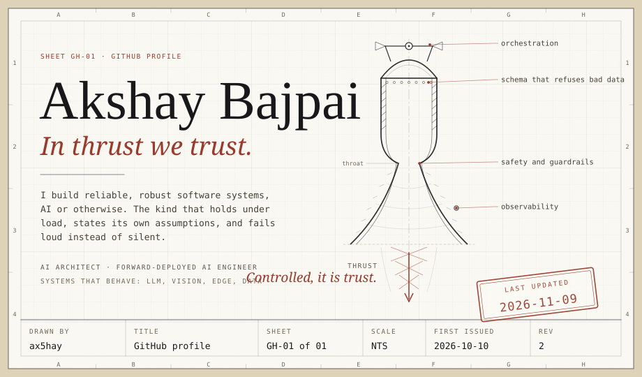
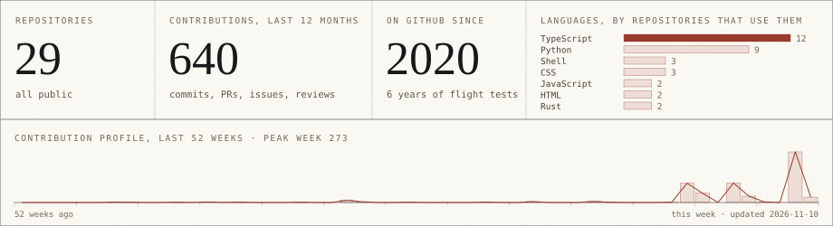

<picture>
  <source media="(prefers-color-scheme: dark)" srcset="assets/dark/hero.svg">
  
</picture>

  <a href="https://www.akshaybajpai.com"><b>akshaybajpai.com</b></a>
  &nbsp;&nbsp;·&nbsp;&nbsp;
  <a href="https://www.linkedin.com/in/ax5hay"><b>LinkedIn</b></a>
  &nbsp;&nbsp;·&nbsp;&nbsp;
  <a href="https://x.com/ax5hay"><b>@ax5hay</b></a>
  &nbsp;&nbsp;·&nbsp;&nbsp;
  <a href="mailto:contact@akshaybajpai.com"><b>contact@akshaybajpai.com</b></a>

Last updated <!-- updated:start -->10 November 2026<!-- updated:end -->. Every plate below is re-issued daily.

 

<picture>
  <source media="(prefers-color-scheme: dark)" srcset="assets/dark/h-notes.svg">
  
</picture>

1. **Thrust is cheap. Controlled thrust is the whole job.** Shipping a demo is thrust. Keeping it upright in production is trust.
2. **I sit on both sides of the table.** In the room with clients and executives for the readout, the scope and the sign-off; back in the code for the hard parts. Nothing is lost in translation, because there is no translation.
3. **I own systems from the first drawing to the runbook.** The architecture, the product, the safety layer, the release, and the team that builds it. The same hands write a Rust power API, a guarded SQL agent and a Terraform module.
4. **Most of the work sits in the unglamorous middle.** Orchestration, the schema that refuses bad data, the job queue that survives a restart.
5. **Decisions are written down.** Decision records, specs, runbooks and handoff notes ship with the code, so the next team starts where I stopped.
6. **Numbers come with their conditions.** When a figure appears in one of my READMEs, a results file sits behind it.
7. **AI where it earns its place.** When a saved answer or a plain rule will do, no model is called. Everything else fails loud.

 

<picture>
  <source media="(prefers-color-scheme: dark)" srcset="assets/dark/h-record.svg">
  
</picture>

What the work was and what it changed, without letterheads or dates. Two of these I ran as CTO, where the architecture, the people and the delivery were one job; the rest I led from the code outward. In most of them I was also the client's main technical voice, from the first scoping call to acceptance.

<table>
<tbody>
<tr>
<td width="200" valign="top"><b>Defence video intelligence</b> agentic AI · air-gapped</td>
<td valign="top">An agentic platform that watches round-the-clock CCTV for government defence deployments. LangGraph and MCP agents triage detections, classify events and escalate alerts; Kafka feeds asynchronous inference; the whole stack runs self-contained on air-gapped, on-premise hardware. I owned the architecture, the inference, the infrastructure and the operators' dashboards. Analyst intervention down 70% &nbsp;·&nbsp; under 200 ms from ingestion to decision</td>
</tr>
<tr>
<td valign="top"><b>Multi-tenant health AI</b> forward-deployed · several clients</td>
<td valign="top">Lead engineer across several client programmes at once, and their main technical voice to product and executive teams. A fertility and surrogacy platform with three coordinated assistants. A governed natural-language-to-SQL agent with schema-grounded routing, query preview, mandatory human confirmation and audit-friendly execution. And the shared LLM layer under every bot: one gateway, tiered routing, hybrid retrieval with reranking, per-bot keys, caching and fallbacks, all on AWS CDK. Reporting rebuilt on 8,000+ approved columns across 193 tables &nbsp;·&nbsp; 100+ legacy prompts retired &nbsp;·&nbsp; full automated pass at staging sign-off</td>
</tr>
<tr>
<td valign="top"><b>Prototype to federal SaaS</b> real-estate AI</td>
<td valign="top">Took an AI prototype of my own and made it a production SaaS platform for a US federal use case, owning the AI workflows, the application, the infrastructure and the delivery. From a working prototype to a deployed product</td>
</tr>
<tr>
<td valign="top"><b>Restaurant-operations SaaS</b> forecasting · event pipelines</td>
<td valign="top">The AI and full-stack engineering for a restaurant platform, and the team of eight that built it: XGBoost and Prophet forecasting behind a Next.js operators' dashboard, and event pipelines designed and load-tested for real-time demand sensing. Validated across 200+ restaurants &nbsp;·&nbsp; 32% less food waste &nbsp;·&nbsp; 2M+ events a day under 100 ms</td>
</tr>
<tr>
<td valign="top"><b>Finance and healthcare AI</b> agents · fine-tuned models</td>
<td valign="top">Agentic finance workflows in LangGraph across risk profiling, rebalancing and onboarding, with tool routing, retries and memory between steps. Multimodal pipelines over health records and diagnostic images, on open models fine-tuned with QLoRA inside HIPAA- and GDPR-compliant AWS, served through hybrid retrieval with reranking and domain guardrails. 60% fewer manual touchpoints &nbsp;·&nbsp; 94% precision &nbsp;·&nbsp; inference cost down 80% &nbsp;·&nbsp; under 800 ms at p95</td>
</tr>
<tr>
<td valign="top"><b>Insurance document intelligence</b> multimodal extraction · RAG</td>
<td valign="top">A production platform for long, messy insurance documents: Claude, GPT-4 Vision and LayoutLMv3 on AWS Bedrock, OCR into retrieval, automated evaluations, and gradient-boosted ensembles for underwriting. 95%+ extraction accuracy &nbsp;·&nbsp; underwriting efficiency up 78% &nbsp;·&nbsp; 10K+ queries a day</td>
</tr>
<tr>
<td valign="top"><b>Clinical NLP</b> health records · risk scoring</td>
<td valign="top">Structured variables pulled out of unstructured health records with BioBERT, spaCy and custom sequence labelling, and the risk-scoring models that fed triage. 47+ variables at 91.5% accuracy &nbsp;·&nbsp; 5K+ documents a day</td>
</tr>
<tr>
<td valign="top"><b>Research</b> published · MSc</td>
<td valign="top">Lead author of a peer-reviewed book chapter on machine learning for medical diagnosis. MSc in Artificial Intelligence and Intelligent Systems with distinction (9.8/10), with a thesis benchmarking nine models for Alzheimer's classification. ISBN 978-3-031-60815-5</td>
</tr>
</tbody>
</table>

 

<picture>
  <source media="(prefers-color-scheme: dark)" srcset="assets/dark/h-keyplan.svg">
  
</picture>

<picture>
  <source media="(prefers-color-scheme: dark)" srcset="assets/dark/keyplan.svg">
  
</picture>

 

<picture>
  <source media="(prefers-color-scheme: dark)" srcset="assets/dark/h-index.svg">
  
</picture>

<table>
<tbody>
<tr><td colspan="3"><b>A</b> &nbsp;·&nbsp; AI AND LLM SYSTEMS</td></tr>
<tr><td width="64" valign="top"><code>A&#8209;01</code></td><td width="150" valign="top"><a href="https://github.com/ax5hay/AURIXA"><b>AURIXA</b></a></td><td valign="top">Multi-tenant conversational care operations. Patients get calm self-service, staff get a shared workspace, platform teams get governed LLM assistance, all over one orchestration and safety layer. TypeScript · Python · Next.js · Fastify · FastAPI · Postgres · Redis · Terraform · EKS</td></tr>
<tr><td valign="top"><code>A&#8209;02</code></td><td valign="top"><b>ReBo</b> private</td><td valign="top">A reports bot for any SQL database that learns from the people who use it. Ask in plain words; it writes one read-only query, runs it, and says how it read the question. Five independent walls stand between a question and a write, from a SELECT-only user to a syntax-tree guard. Repeat questions rerun with no model call; 44 of 48 matching numbers on a test company, at about two cents a question. Python 3.13 · Pydantic AI · sqlglot · SQLAlchemy · FastAPI · MCP · pgvector · React 19 · Phoenix</td></tr>
<tr><td valign="top"><code>A&#8209;03</code></td><td valign="top"><a href="https://github.com/ax5hay/GHDA-SaaS"><b>GHDA-SaaS</b></a></td><td valign="top">Government health-data automation. Turns messy, multilingual survey reports into structured JSON, gap analysis and compliance insight. Fastify gateway · FastAPI services · OCR · Postgres · MinIO · Prometheus</td></tr>
<tr><td valign="top"><code>A&#8209;04</code></td><td valign="top"><a href="https://github.com/ax5hay/OCR-LLM-DIST"><b>OCR-LLM-DIST</b></a></td><td valign="top">Document chat that never leaves the machine. OCR ingestion feeds local LLMs for streaming, grounded answers; Ollama and LM Studio swap freely. FastAPI · Next.js · PyMuPDF · Streamlit · Docker</td></tr>
<tr><td valign="top"><code>A&#8209;05</code></td><td valign="top"><a href="https://github.com/ax5hay/ai-automation-main"><b>ai-automation</b></a></td><td valign="top">Support automation for a publisher. Classifies intent, runs hybrid semantic and keyword retrieval, and unifies one person's identity across WhatsApp, Instagram, email, web and SMS. Node.js · Express · LangChain · Weaviate · Supabase · Twilio</td></tr>
<tr><td valign="top"><code>A&#8209;06</code></td><td valign="top"><a href="https://github.com/ax5hay/JobSlave"><b>JobSlave</b></a></td><td valign="top">Queue roles once; a local LLM answers screening questions while Playwright applies end to end. No cloud LLMs, no form grinding. TypeScript · Electron · Playwright · Drizzle · LM Studio</td></tr>
<tr><td valign="top"><code>A&#8209;07</code></td><td valign="top"><a href="https://github.com/ax5hay/OCR-LocalLLM"><b>OCR-LocalLLM</b></a></td><td valign="top">The single-file version: read a PDF, ask a local model questions grounded in it. Python · Streamlit · PyMuPDF</td></tr>
<tr><td colspan="3"><b>V</b> &nbsp;·&nbsp; VISION, EDGE AND DESKTOP</td></tr>
<tr><td valign="top"><code>V&#8209;01</code></td><td valign="top"><a href="https://github.com/ax5hay/Vigilix"><b>Vigilix</b></a></td><td valign="top">A live, AI-annotated video wall for security teams. RTSP ingest, YOLO overlays, incident alerts, patrol view and multi-tenant licensing. React · Vite · FastAPI · Python vision worker · Postgres</td></tr>
<tr><td valign="top"><code>V&#8209;02</code></td><td valign="top"><a href="https://github.com/ax5hay/DADM-Aiximius"><b>DADM</b></a></td><td valign="top">A distributed defensive-AI mesh. On-device anomaly detection, encrypted federated updates and a defense-ontology graph. Offline-first, zero-trust, air-gap capable. Rust agent · Python · ONNX · Neo4j · Ansible</td></tr>
<tr><td valign="top"><code>V&#8209;03</code></td><td valign="top"><b>FlowState</b> private</td><td valign="top">Video analytics for machines that may not call home. A FastAPI engine runs fifteen detectors across up to six cameras and fuses them into one 0 to 100 threat index, under an Electron and React console. A missing model greys out one detector with the reason named, never the console. Ships air-gapped, with its own Python runtime and bundled weights. Python · FastAPI · Electron · React · YOLO · ONNX Runtime · OpenCV · PyTorch · SQLite</td></tr>
<tr><td valign="top"><code>V&#8209;04</code></td><td valign="top"><a href="https://github.com/ax5hay/KeepMeAwake"><b>KeepMeAwake</b></a></td><td valign="top">Keeps a laptop awake by asking the operating system nicely: a Windows power request or a macOS power assertion, never a fake keypress. Timers, schedules, battery rules, an overnight guard and an almanac of hours, in about 5 MB. A pure Rust core with every OS call behind a trait, signed auto-updates, and five decision records. Rust · Tauri 2 · Svelte 5 · Win32 power requests · IOKit · Windows and macOS</td></tr>
<tr><td colspan="3"><b>D</b> &nbsp;·&nbsp; DATA AND PLATFORMS</td></tr>
<tr><td valign="top"><code>D&#8209;01</code></td><td valign="top"><a href="https://github.com/ax5hay/AIDA"><b>AIDA</b></a></td><td valign="top">Health-facility programme intelligence. Postgres to Prisma to NestJS to Next.js, with an LLM layer that only narrates numbers the API already computed. TypeScript · NestJS · Prisma · Next.js · Recharts</td></tr>
<tr><td valign="top"><code>D&#8209;02</code></td><td valign="top"><a href="https://github.com/ax5hay/RestroScraper-PY"><b>RestroScraper</b></a></td><td valign="top">A lead-generation CRM. Scrapes business profiles, enriches and dedupes them, and tracks every lead through a pipeline. FastAPI · Next.js · Playwright · Selenium · SQLAlchemy · JSONB</td></tr>
<tr><td valign="top"><code>D&#8209;03</code></td><td valign="top"><a href="https://github.com/ax5hay/TracePulse"><b>TracePulse</b></a></td><td valign="top">One decorator for execution tracing in sync and async Python: timings, exceptions and structured logs, at minimal overhead. Python · Loguru</td></tr>
<tr><td valign="top"><code>D&#8209;04</code></td><td valign="top"><b>shelf</b> private</td><td valign="top">An offline-first family reading server, forked and reshaped, with its own decision records and runbook. C# · ASP.NET Core · EF Core · Angular · SQLite</td></tr>
<tr><td colspan="3"><b>W</b> &nbsp;·&nbsp; WEB AND PRODUCT</td></tr>
<tr><td valign="top"><code>W&#8209;01</code></td><td valign="top"><a href="https://github.com/ax5hay/MirrorState"><b>MirrorState</b></a></td><td valign="top">A behavioural enforcement system built on operational evidence instead of self-report. Next.js 15 · React 19 · Fastify · Prisma · BullMQ · Socket.IO · Turborepo</td></tr>
<tr><td valign="top"><code>W&#8209;02</code></td><td valign="top"><a href="https://github.com/ax5hay/akshaybajpai.com"><b>akshaybajpai.com</b></a></td><td valign="top">A personal site issued as numbered architectural sheets, re-issuable in three CSS-only states, with an x-ray lens over any part. 100 on accessibility and SEO, 60 fps on a throttled CPU, no animation or 3D libraries. Next.js 15 · static export · View Transitions API · GitHub Pages</td></tr>
<tr><td valign="top"><code>W&#8209;03</code></td><td valign="top"><a href="https://github.com/ax5hay/medhathapliyal.site"><b>medhathapliyal.site</b></a></td><td valign="top">A notebook-style portfolio with page-turn transitions and full structured data. Astro 5 · View Transitions API · GitHub Pages</td></tr>
<tr><td valign="top"><code>W&#8209;04</code></td><td valign="top"><a href="https://github.com/ax5hay/aiximius.com"><b>aiximius.com</b></a></td><td valign="top">A company site written by hand. No framework, no build step. HTML · CSS · GitHub Pages</td></tr>
<tr><td valign="top"><code>W&#8209;05</code></td><td valign="top"><a href="https://github.com/ax5hay/ew-dashboard"><b>ew-dashboard</b></a></td><td valign="top">A React analytics dashboard with a Testing Library setup. React · Recharts · Tailwind CSS</td></tr>
<tr><td valign="top"><code>W&#8209;06</code></td><td valign="top"><a href="https://github.com/ax5hay/Merakiel.in"><b>Merakiel.in</b></a></td><td valign="top">A doorplate for private client work. The root page publishes nothing; each engagement gets its own surface elsewhere. HTML · CSS · GitHub Pages</td></tr>
</tbody>
</table>

<b>R-01 to R-07</b> · research notebooks from earlier flight tests

 
<table>
<tbody>
<tr><td><code>R&#8209;01</code></td><td><a href="https://github.com/ax5hay/AlzheimersDiagnosis"><b>Alzheimer's thesis</b></a></td><td>Master's research: nine models benchmarked on OASIS clinical and neuroimaging biomarkers to classify dementia.</td></tr>
<tr><td><code>R&#8209;02</code></td><td><a href="https://github.com/ax5hay/GAN-Anime-Faces"><b>Anime-face GAN</b></a></td><td>A generator and discriminator trained against each other until the faces convince.</td></tr>
<tr><td><code>R&#8209;03</code></td><td><a href="https://github.com/ax5hay/CNN-Chinese-MNIST"><b>Chinese MNIST CNN</b></a></td><td>Fifteen handwritten numeral classes across fifteen thousand images.</td></tr>
<tr><td><code>R&#8209;04</code></td><td><a href="https://github.com/ax5hay/RNN_TheSocialDilemma"><b>Tweet sentiment RNN</b></a></td><td>Recurrent models compared side by side on documentary reactions.</td></tr>
<tr><td><code>R&#8209;05</code></td><td><a href="https://github.com/ax5hay/Stock-Market-Prediction-GRU"><b>Stock-price GRU</b></a></td><td>Stacked GRUs over windowed price history. Not financial advice.</td></tr>
<tr><td><code>R&#8209;06</code></td><td><a href="https://github.com/ax5hay/Cervical-Cancer-Classification"><b>Cervical risk classifier</b></a></td><td>Imbalanced clinical data, judged on precision, recall, and ROC-AUC rather than accuracy.</td></tr>
<tr><td><code>R&#8209;07</code></td><td><a href="https://github.com/ax5hay/Hangman_API_Optimisation_Problem"><b>Hangman solver</b></a></td><td>Pattern filtering over a 250k-word dictionary with n-gram back-off for words out of distribution.</td></tr>
</tbody>
</table>

 

<picture>
  <source media="(prefers-color-scheme: dark)" srcset="assets/dark/h-schedule.svg">
  
</picture>

<picture>
  <source media="(prefers-color-scheme: dark)" srcset="assets/dark/schedule.svg">
  
</picture>

The same schedule as text, for searching and copying

 

<!-- schedule:start -->
- **Leadership & practice.** Technical leadership, Building engineering teams, Client & stakeholder ownership, Product strategy & roadmaps, Executive & C-suite readouts, Scope negotiation, Release governance & UAT, Forward-deployed engineering, System architecture, Design docs & specs, Architecture decision records, Runbooks & operations, Security policy & threat modelling, Multi-tenant SaaS design, Air-gapped delivery, LLM evals & cost engineering, Resource & inference budgets, Cross-platform release pipelines, Changelogs & semver, Conventional commits, Handoff notes, Agentic dev workflows, UX writing in plain words, Brand & visual design
- **Languages.** TypeScript, Python, JavaScript, C#, Rust, SQL, Bash, HTML & CSS, SCSS, Cypher, HCL, Google Apps Script
- **Frontend & UI.** React, Next.js, Angular, Astro, Svelte 5, Vite, Create React App, Tailwind CSS, Sass, Bootstrap, Radix UI, shadcn/ui, React Aria, Framer Motion, TanStack Query, Zustand, React Router, RxJS, Storybook, Lucide, Quill, Swiper, remark / rehype, Transloco i18n, View Transitions API, JSON-LD / schema.org, Satori, resvg, cmdk, CodeMirror, Sonner, Liquid Glass (SVG lensing)
- **Charts & dataviz.** Recharts, Observable Plot, uPlot, Apache ECharts, Charts.css, Matplotlib, Seaborn, Plotly
- **Backend & APIs.** Node.js, Fastify, NestJS, Express, FastAPI, Starlette, Flask, Uvicorn, Gunicorn, ASP.NET Core, .NET 8 / 10, Socket.IO, WebSockets, SignalR, Server-sent events, AG-UI event stream, OpenAPI / Swagger, Zod, Pydantic, class-validator, Joi, JWT, OpenID Connect, ASP.NET Identity, Argon2, bcrypt, Helmet, Rate limiting, BullMQ, Hangfire, APScheduler, Lease-based job queue, node-cron, Polly, AutoMapper, Multer, Axios / httpx, aiohttp, Flurl, reqwest, tokio, serde, thiserror, parking_lot, chrono
- **AI & LLM systems.** OpenAI API, Anthropic Claude, Google Gemini, Ollama, LM Studio, Pydantic AI, OpenRouter, LangChain, RAG pipelines, Text-to-SQL agents, MCP servers, LLM guardrails, Prompt & schema contracts, Model cascades, Prompt caching, pydantic-evals, Arize Phoenix, sentence-transformers, fastembed, FAISS, BM25, Reciprocal rank fusion, Weaviate, tiktoken, natural / compromise NLP, fuzzy matching, faster-whisper, Vosk, SpeechBrain, Piper TTS, edge-tts, pyttsx3
- **Machine learning & data science.** PyTorch, torchvision, TensorFlow, Keras, scikit-learn, imbalanced-learn, SHAP, NumPy, pandas, SciPy, scikit-image, joblib, h5py, ndarray (Rust), ONNX, ONNX Runtime, Jupyter, yfinance, jStat, Federated learning, CNNs, RNNs & GRUs, GANs, Anomaly detection
- **Vision, audio & documents.** OpenCV, YOLO / Ultralytics, MediaPipe, dlib, supervision, Pose & posture estimation, PPE detection, ANPR (number plates), Multi-signal threat scoring, Pillow, imutils, RTSP ingest, FFmpeg, PyAV, MoviePy, sounddevice / pydub, EasyOCR, Tesseract, PyMuPDF, pdfplumber, PyPDF2, pdf-parse / pdf.js, Docnet, ReportLab, python-docx, EPUB (VersOne), NetVips, sharp, node-canvas, QR codes, ExcelJS / xlsx, openpyxl, CsvHelper
- **Data stores & ORMs.** PostgreSQL, MySQL / MariaDB, Redis, SQLite, SQLite FTS5, Neo4j, MinIO / S3, Weaviate (vector), FAISS (vector), pgvector, Supabase, Prisma, Drizzle ORM, SQLAlchemy, Alembic, asyncpg, psycopg, sqlglot (SQL ASTs), Entity Framework Core, PL/pgSQL, PostgreSQL row-level security, JSONB storage, cache-manager / EasyCaching, Google Sheets as a store
- **Infrastructure & delivery.** Docker, Docker Compose, Kubernetes, Helm, Terraform, Ansible, AWS, Amazon EKS, Amazon RDS, ElastiCache, Amazon ECR, VPC networking, vSphere, Nginx, GitHub Actions, Dependabot, GitHub Pages, GitHub Releases, Signed auto-updates, NSIS & DMG installers, Relocatable Python runtime, Docker Buildx, crane, Turborepo, pnpm workspaces, npm workspaces, uv, Make, Air-gapped, zero-trust deploys
- **Observability & security.** Prometheus, Grafana, Loki & Promtail, OpenTelemetry, Arize Phoenix tracing, Pino, Winston, Loguru, Serilog, tracing (Rust), TracePulse (my own), Trivy, oauth2-proxy, OS credential store (keyring), Content Security Policy, Secret & PII detection, CodeQL / SARIF, SonarAnalyzer, Codecov, Husky & lint-staged, commitlint, pre-commit, AES-GCM / ring, rustls, cryptography (py), SHA-2 / HMAC, Data Protection API
- **Testing & code quality.** Vitest, Jest, pytest, pytest-asyncio, Playwright, Selenium, Testing Library, jsdom, Supertest, xUnit, NSubstitute, BenchmarkDotNet, criterion (Rust), cargo test, Clippy (pedantic), rustfmt, svelte-check, Golden-set evals, Metamorphic SQL probes, Karma, ESLint, typescript-eslint, Prettier, Ruff, Black, mypy, Pylint, flake8, markdownlint, Storybook a11y
- **Desktop, edge & automation.** Tauri 2, Electron, electron-vite, electron-builder, System tray & menu bar apps, Win32 power requests, IOKit / Core Foundation, Global hotkeys, PySide6 / Qt, Tkinter, Streamlit, NiceGUI, Rust edge agent, sysinfo, Windows API (Rust), Playwright automation, Selenium scraping, BeautifulSoup / lxml, Cheerio, HtmlAgilityPack, SurveyCTO, ngrok
- **Integrations & services.** Twilio, WhatsApp & Instagram channels, Nodemailer, MailKit, Google Sheets API, Google Calendar, Apps Script / clasp, Naukri.com automation, OpenGraph & sitemaps, Webhooks
<!-- schedule:end -->

 

<picture>
  <source media="(prefers-color-scheme: dark)" srcset="assets/dark/h-numbers.svg">
  
</picture>

<picture>
  <source media="(prefers-color-scheme: dark)" srcset="assets/dark/numbers.svg">
  
</picture>

Every plate on this page is drawn by <a href="scripts/render.py">one script</a> from the data in this repository, in the same type and ink as <a href="https://www.akshaybajpai.com">the site</a>, and re-issued daily by a GitHub Action. No third-party stat cards, no grades, no ranks.

 
 

<picture>
  <source media="(prefers-color-scheme: dark)" srcset="assets/dark/closing.svg">
  
</picture>
